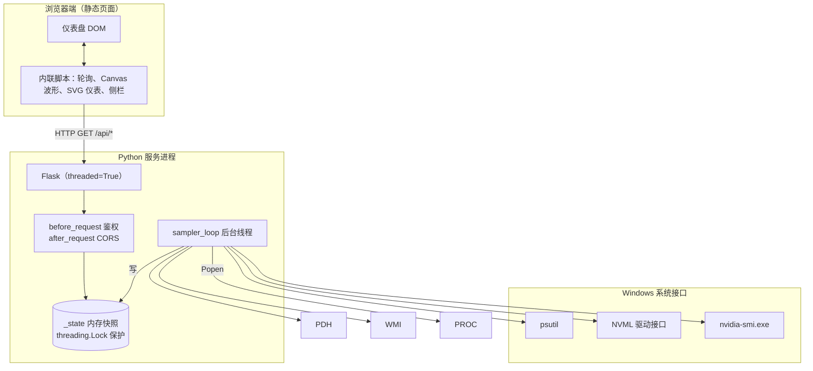
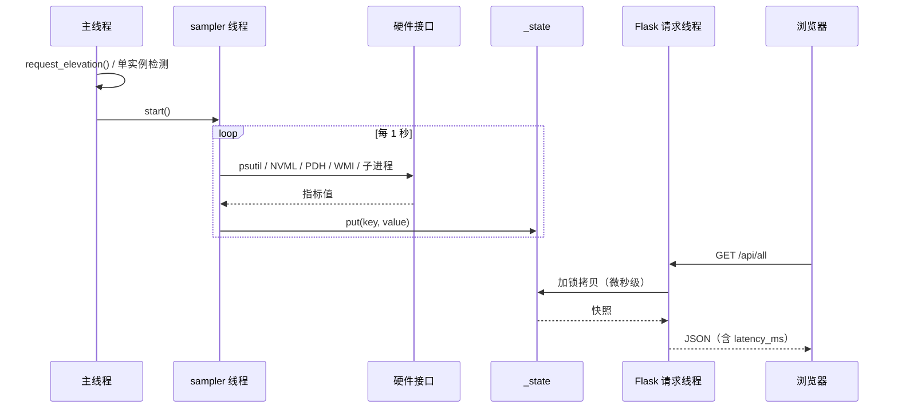
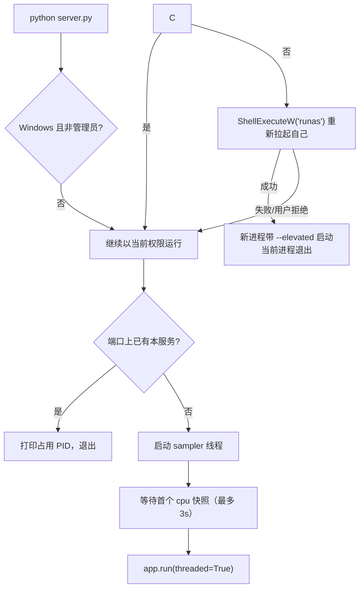
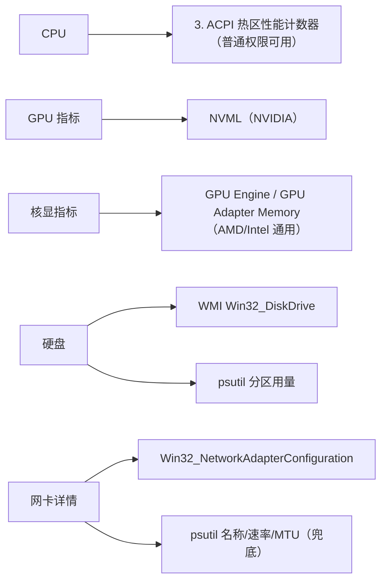

> 注：该硬件指标功能已于 2026-11-05 移除；下文保留为历史归档。

# 01 架构总览

## 1. 系统定位

这是一个面向单台 Windows 主机的只读监控工具，目标是在浏览器里快速看到：

- CPU 总占用、每核心占用、频率、核心数
- 内存用量、进程内存排行
- 磁盘分区用量、物理硬盘型号
- 网络实时速率、网卡 ipconfig 详情
- NVIDIA 独显利用率/显存/引擎、Intel/AMD 核显利用率/共享内存
- 开机时长、进程/线程总数

它不写系统设置、不采集历史数据库、不做告警，也不依赖云服务。

## 2. 组件与边界



职责边界：

- **Flask 层**：只做参数/鉴权、读取快照、序列化 JSON；不执行采样。
- **采样层**：所有耗时操作集中在这里，失败被隔离为 `<key>_error`。
- **硬件适配层**：psutil、NVML、PDH、WMI、外部命令各自封装为函数或类。
- **前端**：纯展示与交互，不计算硬件数据，仅做单位换算、取整和健康度加权。

## 3. 进程与线程模型

单进程，主要线程如下：

| 线程 | 创建位置 | 职责 | 生命周期 |
|---|---|---|---|
| 主线程 | `main()` | 提权、单实例检测、启动采样线程、运行 Flask | 进程存活期 |
| `sampler` | [server.py#L1433-L1434](../server.py#L1433-L1434) | 按节奏采集全部指标并写快照 | daemon，随进程退出 |
| Flask 请求线程 | Werkzeug `threaded=True` | 并发处理 HTTP 请求 | 每请求 |

另有外部子进程：

- `nvidia-smi dmon -s u -c 1`：每 3 秒执行一次，超时 4 秒。
- `nvidia-smi -q`：仅当 `dmon` 解析失败时兜底执行。



## 4. 数据流与快照

快照由模块级字典 `_state` 承载，所有读写都经过 `_state_lock`（[server.py#L85-L111](../server.py#L85-L111)）。

| 快照键 | 写入者 | 频率 | 说明 |
|---|---|---|---|
| `cpu` | `collect_cpu` | 1s | 占用、每核占用、频率、核心数 |
| `memory` | `collect_memory` | 1s | 总量/已用/可用/百分比 |
| `network_speed` | `net_speed` + 相邻两次 `psutil.net_io_counters()` 差分 | 1s | 上/下行速率与累计流量 |
| `gpu` | `NvmlSession.gpu` | 1s | 无 NVIDIA 设备时为 `None` |
| `disk` | `collect_disk` | 3s | 物理盘 + 分区混合数组 |
| `system_info` | `collect_system_info` | 3s | 开机时间、运行时长、进程/线程数 |
| `igpu` | `GpuPerfReader.sample` | 3s | 核显；不可用时为 `None` |
| `gpu_engines` | `collect_engines` + 合并 `gpu` | 3s | CUDA/3D/编码/解码引擎利用率 |
| `_cycle_ms` | `sampler_loop` | 每轮 | 单轮采集耗时，仅供 `/api/all` 的 `latency_ms` |
| `<key>_error` | `put_error` | 失败时 | 字符串错误信息；下次成功时由 `put` 清除 |

设计要点：

1. `put(key, value)` 成功时会先删除 `key_error`，保证错误标记不残留。
2. `collect(key, fn)` 捕获所有异常，只写 `<key>_error`，采样线程继续运行。
3. `/api/all` 过滤以下划线开头的内部键，再补充 `latency_ms`。
4. 单指标接口 `_metric(key)` 在值为 `None` 时返回 503。

## 5. 采样节奏

| 周期 | 内容 | 原因 |
|---|---|---|
| 3.0s（`SLOW_INTERVAL`） | 磁盘、系统信息、核显 | WMI 枚举、进程遍历较重 |
| 3.0s（`ENGINE_INTERVAL`） | `nvidia-smi` 引擎利用率 | 子进程启动开销大 |
| 2.0s（前端 `REFRESH_MS`） | 页面轮询 `/api/all` | 串行调度，上一轮结束后再计时 |
| 5.0s | `/api/network` 缓存 | 侧栏按需拉取 |
| 1.5s | `/api/processes` 缓存 | 侧栏打开时每 2 秒请求 |

采样线程用 `_stop.wait(max(0.05, FAST_INTERVAL - elapsed))` 补偿本轮耗时，避免固定 `sleep` 导致的周期漂移；异常时等待 1 秒后继续下一轮，线程不会因单次错误退出（[server.py#L1154-L1216](../server.py#L1154-L1216)）。

## 6. 目录结构

```text
hardware-monitor-2026-11-03/
├── server.py                 # Flask 应用 + 全部采集逻辑 + 启动流程
├── monitor-mobile.html       # 主页面（/、/monitor-mobile.html）
├── monitor.html              # 桌面版页面（/monitor.html）
├── requirements.txt          # Python 依赖
├── run.bat                   # 普通启动（服务自行请求 UAC）
├── README.md                 # 技术说明与修复记录
├── 使用说明.txt              # 面向普通用户的操作说明
└── docs/                     # 本 Code Wiki
```

## 7. 启动时序



详细步骤与环境变量见 [05 运行与部署](05-运行与部署.md)。

## 8. 指标来源与降级关系


