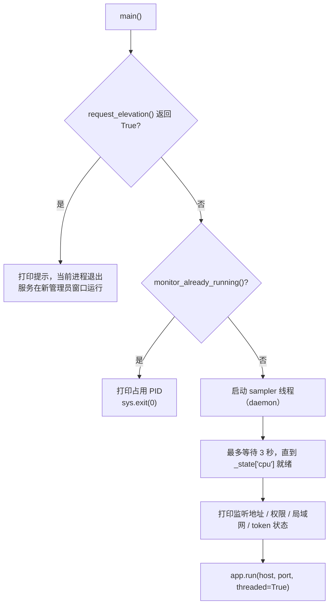

# 05 运行与部署

## 1. 环境要求

| 项目 | 要求 |
|---|---|
| 操作系统 | Windows 10 / 11（核心功能）；其他系统可启动，但 WMI/PDH/温度等会降级或缺失 |
| Python | 3.10 及以上（仓库作者本机依赖装在 3.10） |
| 权限 | 建议管理员；CPU 内核级温度需要管理员 + PawnIO 驱动 |
| 浏览器 | 支持 Canvas、SVG、CSS 变量的现代浏览器 |
| 网络 | 本机访问即可；局域网访问需放行防火墙 |

## 2. 安装依赖

```powershell
py -3.10 -m pip install -r requirements.txt
```

若 `py` 不存在：

```powershell
python -m pip install -r requirements.txt
```

> `PATH` 上的 `python` 可能不是安装了依赖的解释器。启动与安装务必使用同一个 Python。

依赖明细见 [06 依赖与第三方组件](06-依赖与第三方组件.md)。

## 3. 启动方式

### 3.1 推荐：`run.bat`

```bat
cd /d "%~dp0"
py -3.10 server.py
```

双击后：

1. `server.py` 检测到非管理员，调用 `ShellExecuteW(..., "runas", ...)`。
2. Windows 弹出 UAC，点「是」后在新管理员窗口启动服务。
3. 原窗口退出（脚本判断退出码，不额外暂停）。

### 3.2 命令行

```powershell
py -3.10 server.py                 # 自动申请管理员（UAC）
py -3.10 server.py --no-elevate    # 不申请，普通权限运行
py -3.10 server.py --elevated      # 内部使用：标记已提权，防止递归
```

### 3.3 强制提权：`run-admin.bat`

批处理先用 `net session` 检查权限，未提权时通过 PowerShell `Start-Process -Verb RunAs` 重新运行自身，提权后再启动 `server.py`。效果与 `run.bat` 等价，只是把提权放在批处理层。

### 3.4 关闭自动提权

| 方式 | 示例 |
|---|---|
| 命令行参数 | `py -3.10 server.py --no-elevate` |
| 环境变量 | `$env:MONITOR_NO_ELEVATE='1'; py -3.10 server.py` |

普通权限下所有指标照常，只是 CPU 温度降级为 ACPI 平台温度，页面标签显示 `CPU ACPI`。

## 4. 启动流程



关键行为：

- **提权失败不阻塞启动**：用户点「否」或 `ShellExecuteW` 返回错误码时，打印警告并继续以普通权限运行。
- **防止递归提权**：子进程带 `--elevated`，`request_elevation()` 见到后直接返回 `False`。
- **单实例检测**：Windows 允许两个进程绑同一端口，因此启动前主动请求 `127.0.0.1:PORT/api/start`；若返回 200 且含 `"status"`，认为已有实例，打印监听 PID 后退出。
- 端口真正被其他程序占用时，`app.run` 抛 `OSError`，程序打印错误并以 1 退出。

## 5. 访问地址

| 场景 | 地址 |
|---|---|
| 本机主页面 | `http://127.0.0.1:5678/` |
| 本机桌面版 | `http://127.0.0.1:5678/monitor.html` |
| 局域网 | `http://<本机IP>:5678/` |
| 带 token | `http://127.0.0.1:5678/?token=你的口令` |
| 固定暗色/亮色 | `http://127.0.0.1:5678/?theme=dark` 或 `?theme=light` |
| 直达侧栏 | `http://127.0.0.1:5678/#memory`、`#network`、`#disk`、`#cores`、`#gpu` |

首次局域网访问会触发 Windows 防火墙提示，选择「允许访问」。服务本身不安装防火墙规则，也可手动放行 TCP 5678。

## 6. 环境变量

| 变量 | 默认 | 说明 |
|---|---|---|
| `MONITOR_HOST` | `0.0.0.0` | 监听地址；设为 `127.0.0.1` 仅本机可访问 |
| `MONITOR_PORT` | `5678` | 端口；被占用时可换端口 |
| `MONITOR_TOKEN` | 空 | 非空时所有 `/api/*` 需要 `X-Monitor-Token` 头或 `?token=` |
| `MONITOR_CORS_ORIGIN` | `*` | `Access-Control-Allow-Origin` 值 |
| `MONITOR_LHM_DLL` | 自动查找 | 指定 `LibreHardwareMonitorLib.dll` 路径 |
| `MONITOR_NO_ELEVATE` | 空 | `1/true/yes/on` 时关闭自动提权 |

PowerShell 示例：

```powershell
$env:MONITOR_HOST = '127.0.0.1'
$env:MONITOR_PORT = '5679'
$env:MONITOR_TOKEN = 'my-secret'
py -3.10 server.py
```

命令提示符示例：

```bat
set MONITOR_HOST=127.0.0.1
set MONITOR_PORT=5679
py -3.10 server.py
```

## 7. 停止服务

- 在启动的控制台窗口按 `Ctrl+C`，或直接关闭窗口。
- 若窗口丢失，可用任务管理器结束对应的 `python.exe`；也可通过 `/api/start` 确认服务身份后再结束。
- 采样线程和 LHM 子进程均为 daemon/子进程，主进程退出后会一并结束；`lhm_temp.ps1` 的 `finally` 会调用 `Computer.Close()`。

## 8. 开机自启（可选，非仓库内置）

仓库没有提供自启脚本。若需要，可使用 Windows「任务计划程序」创建登录时运行 `run.bat` 的任务，并勾选「使用最高权限运行」，效果等同于每次手动确认 UAC。此配置不在代码中，属于部署环境行为。

## 9. 故障排查

| 现象 | 原因 | 处理 |
|---|---|---|
| 提示端口上已有监控实例（PID xxxx） | 已有实例在运行 | 关闭旧窗口，或 `set MONITOR_PORT=5679` 换端口 |
| 浏览器打不开页面 | 服务未启动/崩溃/地址写错 | 确认控制台无红色报错；访问 `127.0.0.1:5678`，不要访问 `0.0.0.0` |
| CPU 温度显示 `CPU ACPI` 且约 27℃ | 未提权，或 PawnIO 驱动缺失/被拦截 | 用 `run.bat` 并在 UAC 点「是」；安装 PawnIO 或 FanControl；仍不行则内核级读数不可用 |
| 提权后仍是 `CPU ACPI` | HVCI/易受攻击驱动黑名单拦截 PawnIO，或版本不匹配 | 检查 PawnIO 安装；必要时改用 HWiNFO 共享内存方案（需自行扩展） |
| 提示 `No module named 'flask' / 'psutil'` | 安装依赖的解释器与启动解释器不一致 | 用同一个 `py -3.10` 安装并启动 |
| 物理硬盘列表为空 | WMI 在受限账号/沙箱下拒绝访问 | 以普通桌面账号运行；分区用量仍可用 |
| GPU 卡片显示 `--` 或 503 | 非 NVIDIA、驱动未装、NVML 不可用 | 属预期；核显数据走 iGPU 卡片 |
| GPU 引擎为空 | 无 `nvidia-smi` 或命令失败 | 安装 NVIDIA 驱动；日志会提示 `nvidia-smi not found` |
| iGPU 卡片显示「未检测到核显」 | 无核显、PDH 计数器不可用、首次构建失败 | 确认 Windows 性能计数器可用；重启服务可重新尝试构建 |
| 局域网无法访问 | 防火墙未放行或 `MONITOR_HOST=127.0.0.1` | 放行 TCP 端口；检查环境变量 |
| API 返回 401 | 设置了 token 但请求未带 | 在请求头加 `X-Monitor-Token`，或页面 URL 带 `?token=` |
| 页面数据不刷新 | 请求失败/标签页隐藏 | 查看 `#errorState`；页面隐藏时会暂停轮询，切回后立即补拉 |
| 页面显示时间/温度异常 | 采样线程尚未就绪 | 等待 1-3 秒；`/api/all` 的 `latency_ms` 可辅助判断采样是否在跑 |

启动日志含义：

```text
[OK] Hardware Monitor service started at http://127.0.0.1:5678
[OK] 运行权限: 管理员（CPU 温度可读内核级 CPU Package）
[OK] LAN access enabled on port 5678 (set MONITOR_HOST=127.0.0.1 to restrict)
[OK] Token auth enabled (append ?token=... to the page URL)
```

```text
[WARN] CPU 精确温度不可用: ... —— 回退到 ACPI 平台温度
[WARN] NVML unavailable: ...
[WARN] WMI unavailable (physical disk / temp fallback disabled): ...
[WARN] nvidia-smi not found, GPU engine metrics disabled
```

## 10. 部署检查清单

- [ ] Python 3.10+ 与依赖安装在同一解释器
- [ ] `vendor/lhm/` 完整（DLL 与依赖）
- [ ] 需要内核级温度时：管理员运行 + PawnIO 已安装
- [ ] 端口 5678 未被占用
- [ ] 仅本机访问时设置 `MONITOR_HOST=127.0.0.1`
- [ ] 局域网访问时确认防火墙与 token 策略
- [ ] 浏览器能访问 `/api/all` 且 `latency_ms` 为毫秒级
