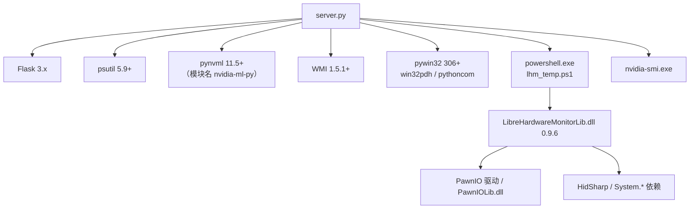

# 06 依赖与第三方组件

## 1. 依赖总览



## 2. Python 依赖

清单见 [requirements.txt](../requirements.txt)：

| 包 | 版本约束 | 用途 | 缺失/失败时行为 |
|---|---|---|---|
| `flask` | `>=3.0` | HTTP 服务、路由、JSON 序列化 | 无法启动 |
| `psutil` | `>=5.9` | CPU/内存/磁盘分区/网络计数/进程/开机时间 | 无法启动 |
| `WMI` | `>=1.5.1` | 物理硬盘、显卡名称、网卡配置、WMI 温度传感器 | `wmi_client()` 返回 `None`，相关指标降级或为空 |
| `pywin32` | `>=306` | `win32pdh`（性能计数器）、`pythoncom`（WMI 初始化） | 核显、ACPI 温度不可用；WMI 可能无法初始化 |
| `pynvml` | `>=11.5` | NVIDIA 显卡利用率、显存、温度 | 导入失败仅打印警告，GPU 指标为 `null` |

补充说明：

- `pynvml` 与 `nvidia-ml-py` 是同一个模块的不同包名；代码忽略导入时的 `FutureWarning`。
- `pywin32` 在部分环境安装后需要执行 `python Scripts/pywin32_postinstall.py -install`，否则 `pythoncom` 可能不可用。
- 只有 NVIDIA 显卡需要 `pynvml`；AMD/Intel 的核显数据走 Windows 性能计数器，不依赖 NVML。
- 非 Windows 系统上 `WMI`/`pywin32` 不可用，程序会捕获异常并降级，但 `requirements.txt` 仍会尝试安装，实际部署建议只在 Windows 使用。

## 3. Windows 系统组件

| 组件 | 作用 | 何时需要 | 缺失影响 |
|---|---|---|---|
| `powershell.exe`（Windows PowerShell 5.1） | 运行 [lhm_temp.ps1](../lhm_temp.ps1) | 读取内核级 CPU 温度 | 跳过 LHM，回退 ACPI |
| `nvidia-smi.exe` | 读取 CUDA/3D/编码/解码引擎利用率 | NVIDIA 显卡 | GPU 引擎为空；利用率/显存仍可由 NVML 提供 |
| PawnIO 驱动（`PawnIOLib.dll`） | LibreHardwareMonitor 0.9.6 读取 MSR 的驱动 | 内核级 CPU 温度 | 传感器能枚举但读数为空，回退 ACPI |
| Windows 性能计数器（PDH） | `GPU Engine`、`GPU Adapter Memory`、`Thermal Zone Information` | 核显、ACPI 温度 | 对应指标不可用 |
| WMI 服务（Winmgmt） | 硬盘型号、网卡配置、温度兜底 | 相关卡片 | 对应字段为空或降级 |
| Google Fonts（`fonts.googleapis.com`） | 页面字体 `DM Mono`、`Noto Sans SC` | 页面美观 | 自动回退系统字体，功能不受影响 |

## 4. `vendor/lhm/` 第三方二进制

目录内容：

| 文件 | 许可 | 用途 |
|---|---|---|
| `LibreHardwareMonitorLib.dll` | MPL-2.0 | 读取 CPU `Package`/`Core` 温度 |
| `HidSharp.dll` | Apache-2.0 | 设备/HID 访问依赖 |
| `System.Buffers.dll` | MIT | .NET 依赖 |
| `System.Memory.dll` | MIT | .NET 依赖 |
| `System.Numerics.Vectors.dll` | MIT | .NET 依赖 |
| `System.Runtime.CompilerServices.Unsafe.dll` | MIT | .NET 依赖 |
| `System.Threading.Tasks.Extensions.dll` | MIT | .NET 依赖 |
| `System.Management.dll` | MIT | WMI 访问依赖 |
| `System.Drawing.Common.dll` | MIT | 图形/设备信息依赖 |
| `NOTICE.txt` | - | 来源、版本、校验值、许可说明 |

来源与版本（[NOTICE.txt](../vendor/lhm/NOTICE.txt)）：

```text
文件版本   0.9.6.0
产品版本   0.9.6+6be33b64e6b37cc3e68c334312657e06fe3385f3
数字签名   有效（CN=Rémi Mercier, O=Rémi Mercier, Québec, CA）
SHA-256    DAB76F326B3D72330615D15255F58A7945375C2DA8A8565A6B343A6C71801BF6
上游       https://github.com/LibreHardwareMonitor/LibreHardwareMonitor
```

使用方式：

1. `LhmReader.find_dll()` 优先使用 `MONITOR_LHM_DLL`，其次是本目录的 DLL，再其次是 FanControl / LibreHardwareMonitor 安装目录。
2. [lhm_temp.ps1](../lhm_temp.ps1) 以字节方式加载 DLL，并注册 `AssemblyResolve` 解析同目录依赖，规避 `LoadFrom` 的 `0x80131515` 错误。
3. 脚本启动时把 `C:\Program Files\PawnIO` 或 `C:\Program Files (x86)\PawnIO` 加入 `PATH`，以便 LHM 通过 P/Invoke 找到 `PawnIOLib.dll`。

升级/替换：

- 可直接用官方新版 `LibreHardwareMonitorLib.dll` 覆盖，但需保证依赖 DLL 同步更新，并检查 PawnIO/WinRing0 驱动要求。
- 也可不修改仓库，通过 `MONITOR_LHM_DLL` 指向其他位置的 DLL。
- 分发时请保留 `NOTICE.txt`，遵守 MPL-2.0 对二进制分发的要求。

## 5. 依赖与功能矩阵

| 功能 | Flask | psutil | pywin32 | WMI | pynvml | PowerShell | LHM DLL | PawnIO | nvidia-smi |
|---|---|---|---|---|---|---|---|---|---|
| CPU 占用/频率/核心 | 必需 | 必需 | - | - | - | - | - | - | - |
| 内存 | 必需 | 必需 | - | - | - | - | - | - | - |
| 磁盘分区 | 必需 | 必需 | - | - | - | - | - | - | - |
| 物理硬盘型号 | 必需 | - | - | 需要 | - | - | - | - | - |
| 网络速率 | 必需 | 必需 | - | - | - | - | - | - | - |
| 网卡 ipconfig | 必需 | 必需 | - | 建议 | - | - | - | - | - |
| 进程排行 | 必需 | 必需 | - | - | - | - | - | - | - |
| NVIDIA GPU | 必需 | - | - | - | 必需 | - | - | - | - |
| GPU 引擎 | 必需 | - | - | - | - | - | - | - | 需要 |
| iGPU | 必需 | - | 需要 | 可选（名字） | - | - | - | - | - |
| CPU 内核温度 | 必需 | - | - | - | - | 需要 | 需要 | 需要 | - |
| CPU ACPI 温度 | 必需 | - | 需要 | - | - | - | - | - | - |
| GPU 温度 | 必需 | - | - | - | 必需 | - | - | - | - |

## 6. 前端外部资源

| 资源 | 地址 | 失败影响 |
|---|---|---|
| Google Fonts CSS | `https://fonts.googleapis.com/css2?...` | 回退 `system-ui` / 等宽字体，布局基本不变 |
| Google Fonts 字体文件 | `https://fonts.gstatic.com` | 同上 |

页面没有引用任何 CDN 上的 JS 库、CSS 框架或图标库；所有样式与脚本均内联，可离线运行（字体除外）。

## 7. 版本与兼容性备注

- Python 3.10 是作者验证过的版本；代码本身使用 f-string、`subprocess.run(capture_output=...)` 等 3.7+ 特性，理论上 3.9+ 可用，但 `requirements.txt` 注释推荐 3.10。
- Flask 3.x 移除了部分旧 API，本项目只使用 `Flask`、`jsonify`、`request`、`send_file`、`abort` 与钩子，兼容 3.x。
- `psutil` 的 `memory_full_info().uss` 在部分进程上会抛 `AccessDenied`，代码已回退到 `memory.private`。
- Windows 性能计数器对象名区分语言环境：代码使用英文对象名（`GPU Engine` 等），在非英文系统上可能枚举失败，此时对应指标降级。
