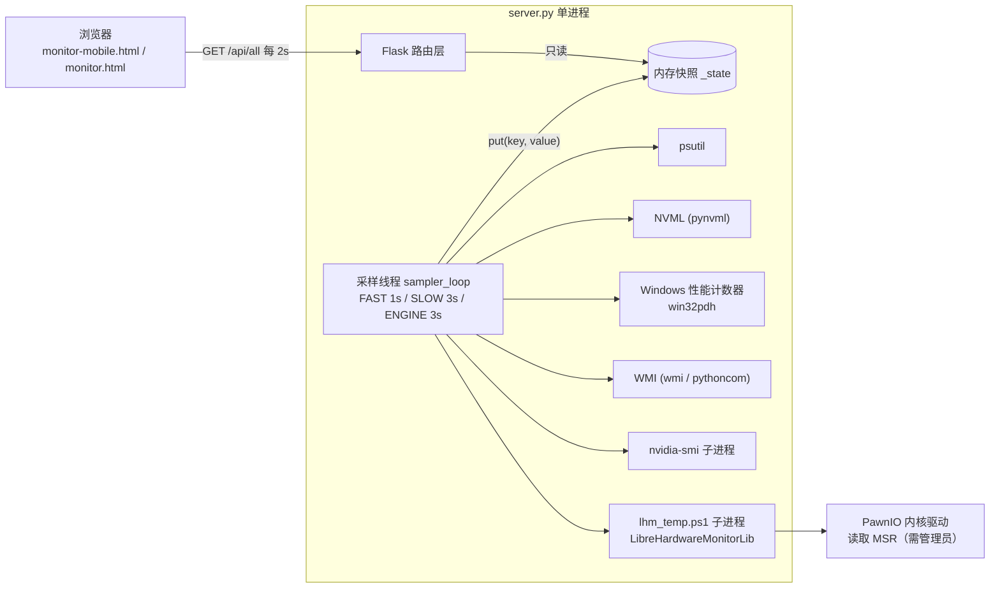

# 硬件资源监控 · Code Wiki

本仓库是一个 **Windows 本地硬件看板**：Python/Flask 后端在后台线程采集硬件指标，写入内存快照；浏览器端是零构建的单页 HTML 仪表盘，每 2 秒读取一次快照渲染。

| 项目属性 | 内容 |
|---|---|
| 运行平台 | Windows 10 / 11（部分指标在其他系统上自动降级） |
| 后端 | Python 3.10+、Flask 3.x、psutil、pywin32、WMI、pynvml |
| 前端 | 原生 HTML + CSS + JavaScript（Canvas / SVG），无框架、无构建步骤 |
| 数据持久化 | 无数据库；仅进程内内存快照 + 少量短时缓存 |
| 部署形态 | 单机单进程，默认监听 `0.0.0.0:5678`，可局域网访问 |
| 外部程序 | `nvidia-smi`、PowerShell、LibreHardwareMonitorLib.dll、PawnIO 驱动 |

## 文档地图

| 文档 | 内容 |
|---|---|
| [01 架构总览](01-架构总览.md) | 系统上下文、进程/线程模型、数据流、采样节奏、状态管理、目录结构 |
| [02 后端模块与关键类](02-后端模块与关键类.md) | `server.py` 分层、采集器清单、`NvmlSession` / `GpuPerfReader` / `LhmReader` / `CpuTemperature` 详解、扩展指南 |
| [03 HTTP 接口参考](03-HTTP接口参考.md) | 全部路由、鉴权/CORS、响应字段、状态码、调用示例 |
| [04 前端页面说明](04-前端页面说明.md) | 两个页面的差异、DOM 结构、Sparkline/仪表盘/侧栏实现、轮询与主题 |
| [05 运行与部署](05-运行与部署.md) | 环境准备、启动流程、UAC 提权、单实例检测、环境变量、故障排查 |
| [06 依赖与第三方组件](06-依赖与第三方组件.md) | Python 依赖用途、Windows 系统组件、`vendor/lhm` 内容与许可 |
| [07 设计决策与已知限制](07-设计决策与已知限制.md) | 关键设计取舍、降级链、安全模型、已知限制与代码阅读发现 |
| [开发执行任务书](开发执行任务书.md) | 交给编码 agent 的跨平台、可复制环境与插件化实施任务书 |
| [T1 完成报告](T1-可复制运行环境-完成报告.md) | 依赖锁文件、bootstrap/lock-deps、doctor、`.venv` 启动入口与三轮评审修复 |
| [T2 完成报告](T2-后端模块化与平台抽象-完成报告.md) | `hardware_monitor` 包结构、Windows/Linux 平台接口、API 变更、回归对比与测试 |
| [T3 完成报告](T3-前端平台适配-完成报告.md) | 同源 `API_BASE`、能力降级（GPU/iGPU/温度）、`hwmon`/`thermal` 标签、平台中性文案与无头浏览器验证 |
| [T4 完成报告](T4-通用插件与缩略组件-完成报告.md) | `/plugin`、`/widget`、`/embed.js`、`/api/plugin/manifest`、安全响应头、postMessage 握手与无头浏览器验证 |

## 快速开始

```powershell
# 1. 首次安装依赖（建议用 py -3.10，确保与启动解释器一致）
py -3.10 -m pip install -r requirements.txt

# 2. 启动（默认自动弹出 UAC 申请管理员权限）
py -3.10 server.py
```

浏览器访问 `http://127.0.0.1:5678/`。详细参数与排障见 [05 运行与部署](05-运行与部署.md)。

## 一分钟看懂系统



核心思想：**把慢操作（`sleep`、子进程、WMI 枚举）全部关进采样线程，HTTP 请求只做字典读取**。因此接口耗时与硬件查询开销解耦，稳定在毫秒级。

## 主要文件

| 文件 | 职责 |
|---|---|
| [server.py](../server.py) | Flask 应用、全部采集器、采样线程、提权与单实例检测 |
| [monitor-mobile.html](../monitor-mobile.html) | 主页面（`/` 返回它），5 个侧栏，手机自适应 |
| [monitor.html](../monitor.html) | 桌面版页面（`/monitor.html`），无 GPU 引擎侧栏 |
| [lhm_temp.ps1](../lhm_temp.ps1) | PowerShell 子进程：加载 LHM 读 CPU 内核温度，逐行输出 JSON |
| [vendor/lhm/](../vendor/lhm/) | LibreHardwareMonitorLib 0.9.6 及依赖、`NOTICE.txt` 许可说明 |
| [run.bat](../run.bat) | 普通启动脚本，优先 `py -3.10` |
| [run-admin.bat](../run-admin.bat) | 批处理内先提权再启动 |
| [requirements.txt](../requirements.txt) | Python 依赖清单 |
| [使用说明.txt](../使用说明.txt) | 面向普通用户的图文式操作说明 |
| [README.md](../README.md) | 原始技术说明与历次修复记录 |

> `README.md` 中提到的 `backup/`（6 月历史快照）当前仓库中不存在，不参与运行。
